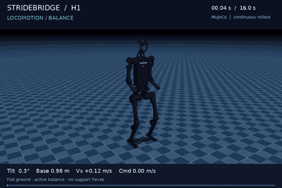
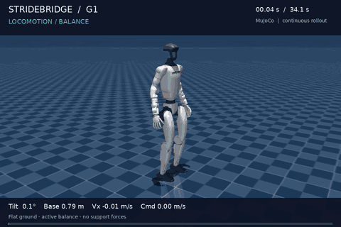
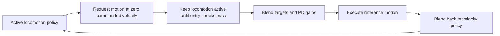

# StrideBridge

**Switch between locomotion and motion imitation while maintaining active balance.**

StrideBridge builds on the latest H1 switching controller and adds a reproducible
G1 demo using public pretrained policies. One command owner blends joint targets
and PD gains, manages motion time, and hands control back to a velocity policy.
At zero commanded velocity, the locomotion policy keeps using live feedback and
may step in place to balance. A nonzero command requests travel.

The current release combines pretrained experts with a deterministic transition
manager. Learning a transition policy is the next research objective.

| H1: walk → active balance → step-over motion → walk | G1: walk → active balance → dance → walk |
| --- | --- |
| [](https://github.com/beiketaoerge/stridebridge/releases/download/v0.1.0/h1_walking.mp4) | [](https://github.com/beiketaoerge/stridebridge/releases/download/v0.1.0/g1_walking.mp4) |

Videos show continuous MuJoCo trajectories at real-time playback speed. Both
demos use flat ground and preset initial poses. The H1 step-over reference is
executed without the obstacle in this release's switching demo.
Active balance here means locomotion with `v_cmd = 0`: inference, feedback,
joint-target updates and the H1 gait phase continue throughout the interval.
The `standing` scenario name also means zero commanded velocity, not locked joints
or a requirement for motionless feet.

## Run the public G1 demo

Use a Python virtual environment from the repository root. Python 3.10 is
recommended; the recorded inference runs used Python 3.8.20.

```bash
python -m pip install -e '.[test]' -c requirements-tested.txt
python scripts/fetch_assets.py
python -m stridebridge.demo --robot g1 --scenario standing --output runs/g1_standing
python -m stridebridge.demo --robot g1 --scenario walking --output runs/g1_walking
python -m stridebridge.render runs/g1_walking
```

Downloads are pinned by Git commit and checked against SHA-256 hashes. They
include the G1 velocity and dance policies, their deployment configurations and
reference motion, robot models, and the official H1/G1 RL Gym locomotion baselines.
Model files are kept out of Git. See the [model catalog](docs/models.md).

Rendering defaults to EGL. On a Linux machine with Mesa/OSMesa installed, use
`MUJOCO_GL=osmesa python -m stridebridge.render runs/g1_walking` for software rendering.
An existing run directory is never overwritten; choose a new output path for a rerun.

## Run the latest H1 policies

The H1 demo uses the project's existing 0816 locomotion checkpoint and 0927
model_30000 motion checkpoint, including the coordinated trailing-leg assist.
These local checkpoints and their motion data are not included in the public
repository. Import your matching bundles using their actual paths:

```bash
python -m pip install -e '.[h1,test]' -c requirements-tested.txt
python scripts/import_h1_assets.py \
  --motion-bundle /path/to/0927 \
  --locomotion-bundle /path/to/h1_deploy_0823
python -m stridebridge.demo --robot h1 --scenario standing --output runs/h1_standing
python -m stridebridge.demo --robot h1 --scenario walking --output runs/h1_walking
python -m stridebridge.render runs/h1_walking
```

The imported assets remain local and are checked before every run. The preserved
[H1 controller](examples/h1_latest/deploy_real_h1_motion_104_h1switch_0927.py)
retains the latest operator, feedback and assist logic; bundle paths are portable.
The new demo calls its migrated policy adapters directly in MuJoCo. See
[H1 lineage and scope](docs/h1.md).

## How switching works



Both experts receive live feedback at 50 Hz. MuJoCo recomputes motor PD torques
at 500 Hz. During a handoff, the interpolation weight is
`w = 3u² - 2u³`, where `u` is elapsed blend time divided by blend duration.
The motion reference starts advancing only when the motion expert has full control.

Each adapter owns its observation/action contract. G1 maps the executed target
back into the velocity policy's action coordinates, keeping its history consistent
during imitation. H1 retains the raw-action conventions of the original controllers.
See [the adapter guide](docs/switching.md) for integration details.

## Recorded results

Each row is one deterministic trial with six seconds of control after handback.
Tilt and velocity below are measured after a one-second settling interval.

| Robot / scenario | Handoff complete | Maximum post-settling tilt | Commanded / mean measured forward speed |
| --- | --- | --- | --- |
| H1 standing | Yes | 2.23° | 0 / −0.001 m/s |
| H1 walking | Yes | 3.23° | 0.60 / 0.359 m/s |
| G1 standing | Yes | 1.33° | 0 / 0.004 m/s |
| G1 walking | Yes | 3.04° | 0.30 / 0.238 m/s |

These runs demonstrate continuous switching and balance in their stated conditions.
They do not establish disturbance robustness or hardware performance. The H1
walking result also shows a velocity-tracking error that remains to be improved.
[Metrics, criteria, failed development trials and environment](docs/validation.md)
are recorded separately from the videos.

```bash
python -m pytest -q
python -B examples/h1_latest/tests/test_operator_flow.py
python scripts/fetch_assets.py --verify-only
```

The release was checked with 11 package tests and the 25 retained H1 operator
regressions. The H1 adapter equivalence test requires the local checkpoint bundles;
CI skips that test when the bundles are absent. ROS installations that inject
unrelated pytest plugins can run with `PYTEST_DISABLE_PLUGIN_AUTOLOAD=1`.

## Toward a learned transition policy

Use this implementation as a baseline for learning when and how to hand over:
collect transition state, expert disagreement, support/contact state, joint
velocities and recovery outcomes; train a high-level policy to choose entry time,
blend duration and bounded corrective actions. Evaluate it on held-out motions,
starting speeds and perturbations against this fixed switching controller.
Zero-command entry and walking-before/after demonstrations are implemented here;
direct switching at arbitrary walking phases and learned transition weights remain
future work.

## Credits

The switching foundation is [h1switch](https://github.com/JamesW546/h1switch).
Public G1 models come from [Unitree RL Lab](https://github.com/unitreerobotics/unitree_rl_lab);
robot descriptions come from [Unitree MuJoCo](https://github.com/unitreerobotics/unitree_mujoco).
The baseline locomotion models come from [Unitree RL Gym](https://github.com/unitreerobotics/unitree_rl_gym).
See [LICENSE](LICENSE) and [third-party notices](THIRD_PARTY_NOTICES.md).
