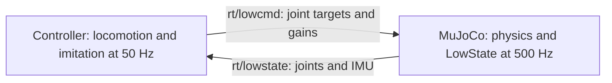

# DDS simulation

`python -m stridebridge.dds_demo` launches a controller and a MuJoCo simulator in
separate processes. Both use Unitree SDK2 and CycloneDDS. Motor commands and live
feedback travel through the standard DDS topics; the controller does not read
simulator state from memory or files.



| Contract | H1 | G1 |
| --- | --- | --- |
| SDK message family | `unitree_go.msg.dds_` | `unitree_hg.msg.dds_` |
| Controlled motors / wire slots | 19 / 20; slot 9 disabled | 29 / 35; slots 29–34 disabled |
| Motor mode | Strong motors `0x0A`, weak motors `1` | Enabled motors `1`, serial pitch/roll mode `0` |
| IMU | Torso measurement converted to pelvis with waist position/velocity | Pelvis measurement |
| Default DDS domain | 181 | 182 |

The simulator publishes actual MuJoCo IMU sensors and joint measurements. It
checks the received command CRC, header/mode, finite values, nonnegative gains,
and disabled motor slots before applying PD plus feedforward torque. The
controller validates state CRCs and rejects stale receipts, frozen/backward ticks
and stale inference snapshots. G1 commands echo `mode_machine` from feedback.
The simulated G1 reports machine mode 0; this is a simulator value.

At `v_cmd = 0`, both policies keep receiving feedback and computing targets.
The H1 gait phase continues. The zero-command intervals and blending settings
match the direct simulation demo. See [the switching contract](switching.md).

## Setup and commands

Use a Linux Python environment with the project dependencies and a working
Unitree SDK2 installation. The tested SDK source is commit
`404fe44d76f705c002c97e773276f2a8fefb57e4`, with Python package version 1.0.1 and
CycloneDDS Python binding 0.10.2. From the repository root:

```bash
git clone https://github.com/unitreerobotics/unitree_sdk2_python.git .cache/unitree_sdk2_python
git -C .cache/unitree_sdk2_python checkout 404fe44d76f705c002c97e773276f2a8fefb57e4
python -m pip install -e .cache/unitree_sdk2_python -c requirements-tested.txt
python -m pip install -e '.[dds,test]' -c requirements-tested.txt
python scripts/fetch_assets.py

python -m stridebridge.dds_demo --robot g1 --scenario walking --output runs/dds_g1_walking
python -m stridebridge.dds_demo --robot h1 --scenario walking --output runs/dds_h1_walking
MUJOCO_GL=osmesa python -m stridebridge.render runs/dds_g1_walking
MUJOCO_GL=osmesa python -m stridebridge.render runs/dds_h1_walking
```

H1 additionally requires Torch and the imported local model bundles described in
the [README](../README.md#run-the-latest-h1-policies). Use `--scenario standing`
for zero commanded velocity before and after motion. Choose a fresh output
directory for each run. A lock prevents these launchers from sharing a DDS domain.

Install SDK2 in editable mode: the tested upstream wheel omits its native CRC
libraries. If CycloneDDS cannot find its native library during installation,
follow the [official SDK installation instructions](https://github.com/unitreerobotics/unitree_sdk2_python#installation).
The implementation follows the [Unitree simulator DDS bridge](https://github.com/unitreerobotics/unitree_mujoco/blob/main/simulate_python/unitree_sdk2py_bridge.py)
and the [G1 low-level message contract](https://github.com/unitreerobotics/unitree_sdk2_python/blob/master/example/g1/low_level/g1_low_level_example.py).

## Timing and failures

Simulation and control have independent wall-clock loops. Physics advances at
2 ms intervals and the controller computes at 20 ms intervals. Neither process
waits for a per-step acknowledgement from the other. The simulator holds the most
recent valid command between packets. It starts physics on the first command;
the preset pose before that command is initialization, outside the episode.
Physics is never frozen while waiting for an entry gate, policy inference or a
packet during the episode.

The default feedback/command timeout is 100 ms. An expired command causes the
simulator to apply damping and end the failed trial after a further 60 ms of
physics. Stale or frozen feedback causes the controller to fail the trial. These
are diagnostic failure responses; damping is not an upright balance controller.

Two deliberate interruption checks are available. They are expected to exit
nonzero and write failure evidence:

```bash
python -m stridebridge.dds_demo --robot h1 --fault command-loss --output runs/dds_h1_command_loss
python -m stridebridge.dds_demo --robot g1 --fault state-loss --output runs/dds_g1_state_loss
```

Each interrupts the selected stream for up to 300 ms starting at simulation
time 3 s. Normal trials also fail if the motion/handoff does not complete, the
robot crosses the documented fall thresholds, post-handoff balance/velocity
criteria fail, packets are rejected, sent commands are missing at the simulator,
or the overall real-time factor is outside 0.95–1.05.

## Evidence and scope

Every run saves separate controller/simulator logs, process IDs and exit codes,
packet counters, timing, manifests with source/asset hashes, and raw trajectories.
`rollout.npz` joins those recordings afterward for video rendering and evaluation.
Simulator truth used to measure speed, height and tilt is never a policy input.
The DDS overlay identifies the transport and shows feedback/command ages.
Feedback age is measured from controller receipt to command publication, and
command age from simulator receipt to its sampled physics step; neither is a
measurement of one-way network latency.

The entry point is restricted to loopback (`lo`) with nonzero DDS domains. These
are asynchronous DDS simulation results on flat ground, with no external support
forces. H1's board remains disabled as in v0.1.0. The run starts from a preset
pose and does not validate physical startup, robot Ethernet, physical actuator
dynamics or hardware safety. The preserved hardware H1 controller remains in
`examples/h1_latest/`; this new runner is a simulation test interface.
